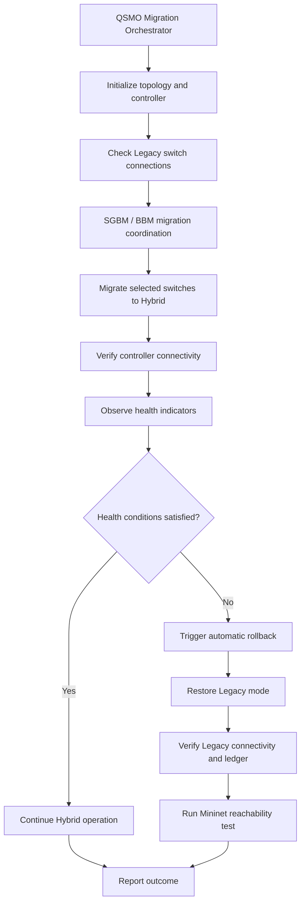

# Quantum Safe Migration Orchestrator (QSMO)

### Hybrid SDN Controller Migration with SGBM, BBM, Health Monitoring, and Automatic Recovery

[](https://ubuntu.com/)
[](http://mininet.org/)
[](https://github.com/faucetsdn/ryu)

QSMO Migration-Orchestrator is a research and demonstration system for coordinating Software-Defined Networking (SDN) controller migration between a **Legacy** mode and a **Hybrid** mode. It combines migration coordination, controller-connection verification, health monitoring, rollback decisions, and network reachability validation in an emulated environment.

> **Demonstration note:** The integrated rollback scenario uses deliberately injected synthetic health values to exercise recovery. These values are test inputs, not measurements from a production network.

---

## Contents

- [Project at a glance](#project-at-a-glance)
- [Capabilities](#capabilities)
- [Architecture and workflow](#architecture-and-workflow)
- [Demonstration environment](#demonstration-environment)
- [Repository layout](#repository-layout)
- [Prerequisites](#prerequisites)
- [Initial setup](#initial-setup)
- [Running the demonstration](#running-the-demonstration)
- [Changing the topology](#changing-the-topology)
- [Validate network connectivity](#validate-network-connectivity)
- [Run tests](#run-tests)
- [Demonstrated results](#demonstrated-results)
- [Monitoring scenario](#monitoring-scenario)
- [QSMO Console API](#qsmo-console-api)
- [Logs and troubleshooting](#logs-and-troubleshooting)
- [Limitations](#limitations)
- [Future work](#future-work)

## Project at a glance

| Item | Description |
|---|---|
| Domain | Software-Defined Networking (SDN) |
| Main purpose | Coordinated controller migration and recovery |
| Migration workflow | SGBM and BBM components |
| Network environment | Mininet and Open vSwitch |
| Controller framework | OS-Ken |
| Demonstrated topology | 7 switches and 8 hosts |
| Demonstrated migration targets | `s1`, `s2`, and `s5` |
| Validation | Controller-state checks, migration ledger, and Mininet `pingall` |

## Capabilities

- **Migration coordination:** Coordinates selected switch migration through the SGBM/BBM workflow.
- **Hybrid migration:** Moves selected switches from Legacy mode to Hybrid mode.
- **Connection verification:** Checks switch/controller connectivity and migration verification samples.
- **Health monitoring:** Evaluates latency and failure-rate indicators against configured thresholds.
- **Automatic rollback:** Reverts a migrated switch when the configured demonstration health conditions are violated.
- **Outcome tracking:** Records migration and rollback outcomes in the migration ledger.
- **Network validation:** Uses Mininet host reachability tests to check connectivity after recovery.
- **Any-topology support:** Topology is defined in a single file (`network/topo.py`); coverage model, optimizer, monitor, certificates, ports and flows adapt automatically.
- **Management console API:** FastAPI backend for a management dashboard.

## Architecture and workflow



## Demonstration environment

The integrated demonstration was run in an Ubuntu virtual machine with:

- Python 3
- Mininet
- Open vSwitch (OVS)
- OS-Ken
- stunnel and OpenSSL
- Git

The default demonstration topology contains seven switches and eight hosts. Network emulation and controller operations require elevated privileges (`sudo`).

## Repository layout

```text
Migration-Orchestrator/
├── controller/          # SDN controller application and switch behavior
├── network/             # topo.py (the only file to edit per topology), coverage model, flow generator
├── migration/           # Migration workflow, port registry, certificates, monitoring
├── optimizer/           # SGBM optimizer, capability tracker, experiments
├── console/             # FastAPI management-console API (+ ENDPOINTS.md)
├── tests/               # Integration, monitoring and any-topology tests
├── sync_topology.sh     # Regenerates flows / ports / Hybrid certs for the running topology
├── run_network.sh       # Starts the Mininet topology
├── run_controller.sh    # Starts the OS-Ken controller
├── run_monitor.sh       # Starts the health monitor
├── run_migration.sh     # Runs the SGBM migration
└── README.md            # Project documentation
```

## Prerequisites

Install or configure the following in a supported Ubuntu environment:

- Git and Python 3
- Mininet
- Open vSwitch
- OS-Ken and the Python dependencies required by this repository
- stunnel and OpenSSL

Mininet and Open vSwitch require system-level configuration and appropriate privileges.

## Initial setup

Run once. Clone the repository and prepare the Python environment:

```bash
git clone https://github.com/Ruvanthi1075/Migration-Orchestrator.git
cd Migration-Orchestrator
git checkout monitor
python3 -m venv .venv
source .venv/bin/activate
python -m pip install --upgrade pip
python -m pip install -r requirements.txt   # if present
```

Point the stunnel config at your local clone instead of the original author's path:

```bash
sed -i 's#/home/ruvan/Migration-Orchestrator#'"$PWD"'#g' migration/hybrid/stunnel/server.conf
grep -n "/home/" migration/hybrid/stunnel/server.conf   # verify: should only show your path
mkdir -p migration/hybrid/stunnel/logs
```

## Running the demonstration

Open separate terminals and run the following **in order**, from the repository root. Keep each one running.

**Terminal 1 — Network**

```bash
./run_network.sh
```

**Terminal 2 — Controller**

```bash
./run_controller.sh
```

**Another terminal — Sync (flows, ports, Hybrid certificates)**

```bash
sudo chown -R $USER:$USER migration docs network reports 2>/dev/null
bash sync_topology.sh
ls migration/hybrid/certs/
```

**Terminal 3 — Monitor**

```bash
./run_monitor.sh
```

**Terminal 4 — Migration**

Default (`beta = 0.5`):

```bash
sudo ./run_migration.sh
```

Change the migration budget:

```bash
./run_migration.sh migrate --beta 0.7    # migrate more switches
./run_migration.sh migrate --beta 1.0    # migrate everything
```

Pick specific switches (this ignores the budget):

```bash
./run_migration.sh migrate --switches s3,s5
```

Verify controller connections:

```bash
sudo ovs-vsctl list Controller | grep -E "target|is_connected"
```

A successful integrated run includes the marker:

```text
INTEGRATED LIVE SGBM + MONITOR + AUTOMATIC ROLLBACK PASSED
```

The exact log details and results can vary by environment.

To clean up between runs:

```bash
sudo pkill -9 -f osken-manager; sudo pkill -9 stunnel
sudo mn -c
```

## Changing the topology

`network/topo.py` is the single place the topology is defined. Everything else adapts automatically.

Pick a built-in shape or edit the `TOPOLOGY = ...` line in `network/topo.py`:

```bash
sudo python3 network/topo.py --topology ring:6   # default | line:N | ring:N | star:N | mesh:N | tree:DEPTH:FANOUT
```

To apply a new topology:

1. Regenerate certificates:

   ```bash
   rm -rf migration/certs migration/hybrid/certs
   ./migration/gen_certs.sh
   openssl verify -CAfile migration/certs/ca.cert migration/certs/controller.cert migration/certs/switch.cert
   ```

2. Start again with the [Running the demonstration](#running-the-demonstration) steps.

If the topology definition changed, also re-run `bash sync_topology.sh` so flows, ports and Hybrid certificates match.

Rules enforced before Mininet starts: unique non-zero 16-hex dpids, connected switch graph, hosts attached to existing switches. STP is enabled only when the topology contains a loop.

Offline verification (no Mininet needed): `python3 tests/test_any_topology.py` runs the real coverage model and SGBM optimizer over 17 topology shapes; `python3 -m optimizer.run_experiment --topology ring:6` runs the budget sweep on one.

## Validate network connectivity

When the Mininet command-line interface is available, run:

```text
mininet> pingall
```

A successful run should report no dropped packets for the tested topology. To leave the Mininet CLI:

```text
mininet> exit
```

## Run tests

The repository includes tests for monitoring, migration, rollback, and topology integration under `tests/`.

Topology-independence check (offline): `python3 tests/test_any_topology.py`.

General invocation:

```bash
python3 -m pytest tests/
```

Some integration tests require Mininet, OVS, OS-Ken, elevated privileges, or a configured network environment. If a test fails because a system dependency is missing, install or configure that dependency before interpreting the result as a code failure.

## Demonstrated results

In the recorded integrated demonstration:

- Initial controller preflight reported **7/7 switches connected**.
- Switches `s1`, `s2`, and `s5` migrated to Hybrid mode.
- Hybrid controller connectivity and verification samples completed for the selected switches.
- The configured health scenario triggered automatic rollback.
- The selected switches returned to Legacy mode and their controller connections were verified.
- The migration ledger recorded migration and rollback outcomes.
- Mininet `pingall` reported **56/56 responses received (0% packet loss)**.

These are results from a demonstrated run, not a guarantee that every environment or execution will produce identical results.

## Monitoring scenario

The integrated rollback demonstration deliberately injects synthetic values to exercise the recovery path:

| Indicator | Demonstration input | Configured threshold |
|---|---:|---:|
| Latency | 1000 ms | 100 ms |
| Failure rate | 0.50 | 0.10 |

Because the inputs are intentionally outside the configured thresholds, the scenario exercises the automatic rollback behavior. **Do not describe these injected values as live production measurements.**

## QSMO Console API

`console/` is a FastAPI backend (no authentication) for a management dashboard:

```bash
pip install -r console/requirements.txt
uvicorn console.main:app --port 8000
```

Then open `/docs`. See `console/ENDPOINTS.md`.

## Logs and troubleshooting

Use the controller terminal output to review controller startup, switch connections, migration events, health observations, rollback decisions, and final checks.

Useful checks:

```bash
git status
python3 --version
which mn
which ovs-vsctl
sudo ovs-vsctl list Controller | grep -E "target|is_connected"
```

If the demo cannot start:

- Run the cleanup commands (Running the demonstration) to kill stale `osken-manager`/`stunnel` processes and reset Mininet.
- Confirm Mininet and OVS are installed and commands are run from the repository root.
- Confirm certificates exist in `migration/certs/` and `migration/hybrid/certs/`.
- Identify the relevant error in the log before changing files or controller configuration.

## Limitations

- The documented workflow is demonstrated in an emulated Mininet environment.
- The rollback demonstration uses synthetic health inputs.
- Results depend on software versions, system configuration, privileges, and runtime conditions.
- Emulation results alone do not establish production-network performance, scalability, or security.

## Future work

- Add a pinned, reproducible dependency specification.
- Expand automated tests across additional topology sizes and failure cases.
- Export structured experiment results for easier comparison.
- Evaluate monitoring with realistic measured traffic and clearly documented test conditions.
- Improve setup checks and troubleshooting guidance.

## Disclaimer

This project is intended for research, development, and controlled demonstration. Review and validate configuration, dependencies, and operational behavior before using any component in a real network.
